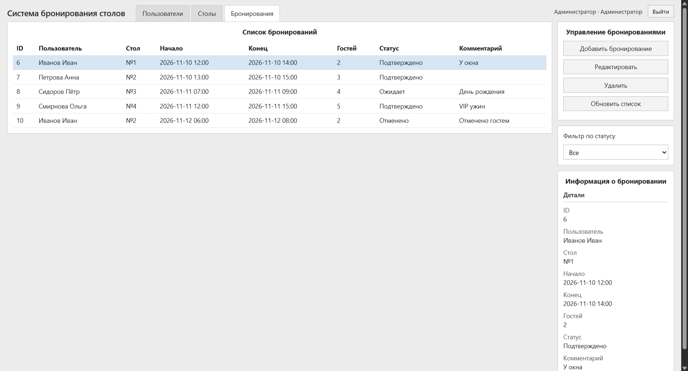
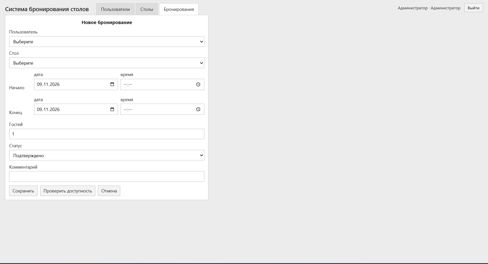

# Система бронирования столов ресторана

> Веб-приложение для учёта гостей, столов и бронирований с проверкой конфликтов по времени, ролями доступа и деплоем через Docker Compose.

## Проблема

В ресторане брони часто ведут в чатах, блокнотах или разрозненных таблицах: легко поставить две компании на один стол, забыть про вместимость или дать всем сотрудникам полный доступ к базе гостей. Из‑за этого появляются накладки на смене, ручные перепроверки и лишняя нагрузка на администратора.

## Решение

Сделано внутреннее веб-приложение: сотрудники входят по ролям, ведут гостей, столы и брони в одном интерфейсе. Система сама проверяет пересечения по времени, активность стола и число гостей, защищает формы CSRF-токеном и поднимается одной командой в Docker вместе с PostgreSQL.

## Что внутри

- Технологии: Python 3.11, Flask, Gunicorn, PostgreSQL, Docker Compose, Jinja2, Flask-WTF (CSRF)
- Архитектура: 3 слоя — веб (`app.py`) → бизнес-правила (`backend.py`) → драйвер PostgreSQL (`postgres_driver.py` + модели)
- Безопасность: вход по email/паролю, роли `admin` / `staff` / `customer`, хеши паролей, секреты только из `.env`
- Деплой: VPS + Docker Compose (Gunicorn + Postgres в одной сети, БД не публикуется наружу)

## Как запустить

```bash
git clone https://github.com/oeshev-ai/Restaurant-table-booking.git
cd Restaurant-table-booking
cp .env.example .env   # задайте DB_PASSWORD и SECRET_KEY
docker compose up --build -d
docker compose exec web python seed_data.py
```

Откройте [http://127.0.0.1:5000](http://127.0.0.1:5000).

Демо-вход после seed:

| Роль          | Email               | Пароль     |
|---------------|---------------------|------------|
| Администратор | `admin@example.com` | `admin123` |
| Сотрудник     | `staff@example.com` | `staff123` |

## Результат

- Конфликты броней, неактивные столы и переполнение по местам отсекаются до сохранения
- Разделение прав: admin управляет пользователями, staff — столами и бронями, гости в UI не входят
- Запуск окружения и БД одной командой `docker compose up`

### Скриншоты

Список бронирований:



Форма бронирования с проверкой доступности:



## Контакт

Telegram: [@OEShevchenko](https://t.me/OEShevchenko)  
Email: [oeshevip@yandex.ru](mailto:oeshevip@yandex.ru)
